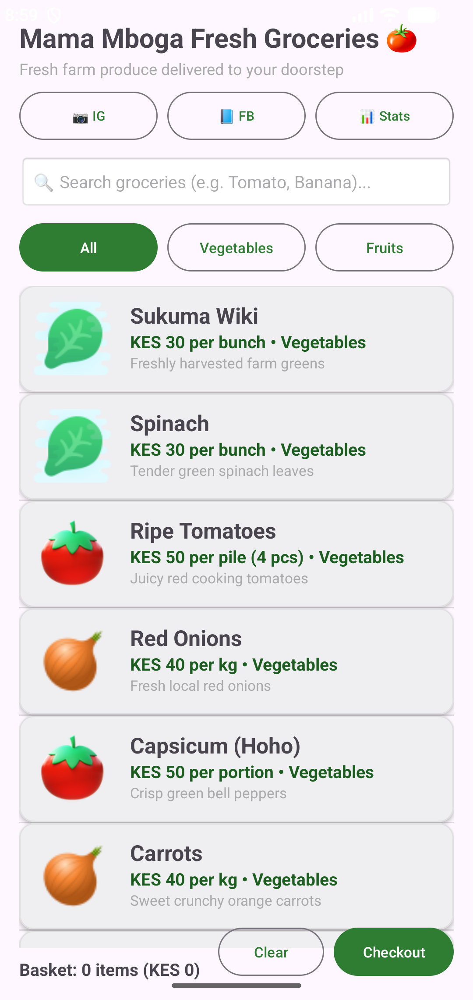
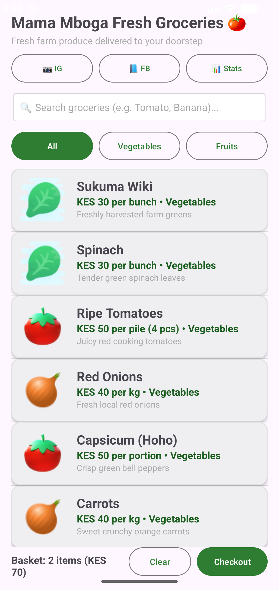

# 🍅 Mama Mboga App

A modern, professional-grade Android e-commerce and grocery shopping application designed for local fresh produce delivery (Mama Mboga), built with Kotlin and Material Design 3.

## 📱 App Screenshots

| Main Store Catalog | Store Stats & Analytics | Payment Gateway (M-Pesa) |
| :---: | :---: | :---: |
|  |  |  |

## ✨ Professional Features
- **Modern Material 3 UI**: Card-based product presentation with smooth elevations and a fresh grocery green theme (`MaterialCardView`).
- **Real-Time Search**: Instant search functionality to filter produce by name or description.
- **Category Filtering**: Quick filter buttons for "All", "Vegetables", and "Fruits".
- **Advanced Payment Gateway**: Supports **M-Pesa (Lipa na M-Pesa STK Push)**, Credit/Debit Cards, and Cash on Delivery with order receipt generation.
- **Store Analytics & Charts Dashboard**: Live store statistics tracking catalog distribution (Vegetables vs. Fruits), total orders placed, and live basket valuation.
- **Social Media Integration**: Direct links to Instagram and Facebook via Android Intents.

## 📱 Tech Stack & Architecture
- **Language**: Kotlin
- **UI Toolkit**: Android Views, ConstraintLayout, Material Components, Material3 CardView, AlertDialogs
- **Core Components**: Custom `ArrayAdapter`, Implicit Intents, TextWatchers for real-time search, Dialog-based workflows

## 🚀 Getting Started
1. Clone the repository:
   ```bash
   git clone https://github.com/officialnuur/Mama-mboga-app.git
   ```
2. Open the project in **Android Studio**.
3. Sync Gradle and run on an emulator or physical device.

---
*Built with passion for local fresh produce deliveries.*
